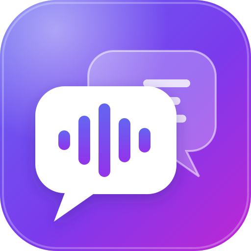

<div class="hero" markdown>


# OneVoice

**Live captions and translation for church services, on everyone’s phone.**
Scan a QR code, pick a language, follow along. No app, no account.

[Install it](DEPLOYMENT.md){ .md-button .md-button--primary }
[Download the Sender app](https://github.com/Nick-116/OneVoice/releases/latest){ .md-button }
[View on GitHub](https://github.com/Nick-116/OneVoice){ .md-button }
</div>

## Why OneVoice exists

OneVoice was designed for a church that wanted a **cheap, simple way to help congregation members who speak other languages understand the message**. During the live service, it:

1. takes the pastor’s words from the sound board;
2. turns them into text;
3. translates that text into each member’s language;
4. shows it on their own phone, as it’s spoken.

It **translates a live service into many languages at once**, for the people sitting in that service. It doesn’t relay or translate content between campuses. A church with several campuses simply runs a separate, independent caption stream for each one.

Hardware interpretation systems and human interpreters for every language are expensive. OneVoice is the low-cost alternative:

* **For the congregation:** scan the QR code, choose a language once (it’s remembered), read along. Text is large, adjustable and works in 12 languages out of the box, including right-to-left Arabic.
* **For the church:**
  - It runs on a small server (no GPU) and costs a few dollars of API usage per service.
  - A web dashboard handles service times, languages, branding and updates.

## How it works

```
 Sound board ──Dante / USB──► OneVoice Sender ──► OneVoice server ──► speech-to-text API ──► translation API
 (speech mix)                 (Mac or Windows        (Docker)              (Deepgram…)           (Azure…)
                               on the church network)     │
                                                          └──► phones in the room (live captions, per language)
```

**Audio input:** the speech mix reaches OneVoice in one of two ways:

- from an audio interface plugged into the OneVoice server itself (the default, when the server is at the church);
- from the **OneVoice Sender** app on a church computer (when the server is elsewhere, like a VPS).

**Our setup:**

- The OneVoice server runs on a **VPS** (a small cloud server).
- The **OneVoice Sender** app runs on a computer on the **church’s local network** and sends the speech mix to the VPS.
- Phones reach the caption site over the internet.

**Other setups work too:**

| Setup | When it fits |
|---|---|
| **VPS + Sender on the church network** (what we use) | Most reliable; phones can use cellular data or Wi-Fi; easy to reach from anywhere. |
| **Everything on one computer at the church** | No VPS cost. Run the server with Docker on the same Mac/PC as the Sender (or another machine on the network). |
| **Local network only, plain HTTP** | Simplest. Phones on the church Wi-Fi open `http://<server-ip>:8080/campus/<campus>`. |

## Features

- **Two audio sources per campus:** a **local input** on the OneVoice server (the default; for example a USB or Dante interface plugged into it), or the **OneVoice Sender** app on a church computer when the server is a VPS. See [AUDIO.md](AUDIO.md).
- **Live captions** in the original language (word-by-word) and **translated** captions per sentence, delivered with Server-Sent Events.
- **Scheduling:**
  - Weekly services, special and holiday services, cancellations.
  - Manual start, stop and extend, plus an early-access window.
  - A countdown before the service and a thank-you screen after.
  - Daylight-saving-time correct.
- **Honest status:** viewers see “Waiting for live captions…” or “The streaming service is currently not connected. Please check with the production team.” Captions never pretend to be live.
- **Multiple campuses (optional):** each campus is independent, with its own service times, audio input, languages, QR code and captions. Nothing is shared or translated between campuses.
- **Pays only for what’s used:**
  - One translation per language, shared by every phone reading it.
  - A language is only translated while someone is reading it. When the last person switches away, it stops about 15 seconds later.
  - Nothing runs outside service times.
- **Branding:** church name, logo (PNG), button color and fonts (text and church name separately), all set in the dashboard. Colors are automatically adjusted for readable contrast.
- **First-run setup wizard:** create the first admin (protected by a one-time setup code), enable two-factor sign-in, choose and test the speech-to-text and translation providers.
- **One-click updates** from GitHub in the dashboard, with an automatic database backup and rollback.
- **Security:**
  - Only the caption site is meant to be public, and it’s read-only.
  - The admin dashboard requires a password plus an authenticator code.
  - Audio senders use revocable tokens and can be restricted by IP.
  - Containers run as non-root.
- **Monitoring:** live latency (p50/p95), viewers per language, audio levels, provider health, usage and estimated cost.

## Speech and translation providers (API usage)

OneVoice doesn’t run AI models itself. It uses **external speech-to-text and translation APIs**, which bill for usage: minutes of audio and characters translated. You create the accounts and paste the keys into the setup wizard. Keys are stored encrypted in your own database.

| | **Tested with** (what we use) | Also supported |
|---|---|---|
| Speech-to-text | **Deepgram** (Nova-3, streaming) | AssemblyAI (Universal-Streaming) |
| Translation | **Azure AI Translator** | Google Cloud Translation |
| Testing | Simulated providers (free, no keys) | |

**Typical cost:** 4 services a week of 1.5 hours each, with 3 translated languages:

- Deepgram: about **$12/month**
- Azure: about **$30–40/month**

**Credits for nonprofits and new accounts:**

- **Microsoft for Nonprofits:** eligible 501(c)(3)s can get **$2,000/year in Azure credits**, which covers translation entirely at this scale.
- **Deepgram:** new accounts get **$200 of free credit** (well over a year at the usage above). Deepgram doesn’t publish a nonprofit discount, but it’s worth asking their sales team.
- **Azure Translator** also has a free tier of 2 million characters per month.
- Prices and programs change, so check the providers’ current terms. See [PROVIDERS_AND_PRIVACY.md](PROVIDERS_AND_PRIVACY.md) for details and privacy notes.

The provider system is modular: a self-hosted speech or translation model can be added later as a single class.

